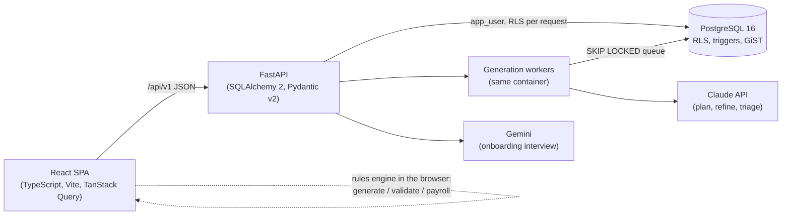

# ShiftPlanner

**An AI-assisted back office for restaurants and bars in Spain: staff rotas that respect Spanish labour law, stock that updates itself from sales, and a simple till, in one multi-tenant web app.**


> **This is a public snapshot of a private production repository.** Client data has been replaced with a demo business ("Casa Demo") and the git history is not included. The original repo has **200 merged pull requests and 461 commits between 31 Aug and 30 Sep 2026**. It runs in production on Railway, and a real restaurant is using it.

| | |
|---|---|
| Backend tests (pytest, against a real Postgres) | **2,125** |
| Frontend tests (Vitest) | **2,007** |
| Alembic migrations | **47** |
| Eval cases for the AI dev agents and skills | **47** |

---

## What it is

Small hospitality businesses in Spain still plan shifts in spreadsheets and WhatsApp groups and count stock by hand. The law they have to follow is strict and easy to get wrong. The 40-hour week is an **annual average**, not a weekly cap. Each person needs 12 hours of rest between shifts and a day and a half off every week, and overtime is measured against each person's own contract.

ShiftPlanner puts three apps behind one login. The owner picks which apps each business gets.

| App | Who uses it | What it does |
|---|---|---|
| **Shifts** | Manager, employees | The manager describes the business in plain language (by typing or dictating). The app drafts the month's rota, and the manager can drag shifts to adjust it before publishing. There are views for the calendar, payroll and each person's working year. Employees see their own rota and who they work with, can request time off, and are told exactly what changed when a rota is republished. |
| **Inventory** | Manager, employees, till tablet | Stock counts, deliveries received with a barcode gun or the phone camera, and product photos. Low-stock alerts turn into a ready-to-send WhatsApp order for each supplier. |
| **Store** | Manager, employees, till tablet | The menu laid out as a touch-screen till: tap dishes onto a bill and take payment (cash with change, or card confirmed by hand). Also sales history and statistics, plus **recipes**, so each sale deducts its ingredients from stock. |

## Highlights

### The AI proposes, deterministic code decides
- **The manager's brief becomes a typed spec.** Claude turns free text into a closed schema using structured outputs. The planner then asks for the rota **one month per call**, with the months running concurrently.
- **The model's output is a proposal, not a calendar.** The client parses and prices it, then checks it against the same rules the deterministic greedy generator uses (`validate.ts` imports its limits from `generate.ts`). Any shift that breaks a hard rule is dropped, and the generator fills the gaps. In the worst case the manager gets the calendar the product would have built without AI.
- **It still works with no API key.** Briefs are parsed locally and the greedy generator builds the calendar.
- **Privacy by construction.** No salaries, pay rates, absence reasons or names are sent to a model. People and templates go out as `e1`/`t1` aliases, and names in the manager's sentences are masked the same way. The aliases also cut a month's output from 12,001 to 6,090 tokens (`services/id_alias.py`).
- **The right model for each job.** Claude Opus plans, Claude Haiku triages corrections and reads the manager's daily notes, and Gemini Flash-Lite runs the onboarding interview, with Haiku as fallback and a circuit breaker. Prompts are cached. **Each organisation's AI cost is metered** in an `api_usage` table.
- **Corrections are remembered, without silent guesses.** A correction the manager keeps making becomes a learned rule. It applies only where the brief says nothing, and it stays visible so the manager can remove it. The brief always wins. Industry templates are offered as suggestions and never applied on their own, and any field that falls back to a default is shown to the manager.

### Spanish labour law as data, not code
- Rules are seeded for each jurisdiction in `compliance_rule`: the Spanish statute (`ES`), the Catalan hospitality collective agreement, and a retail profile. Each rule cites its article of the *Estatuto de los Trabajadores*. They cover rest between shifts and daily hours (art. 34.3), weekly rest (art. 37.1), the annual average (art. 34.1; 1,783 h/year under the hospitality agreement) and irregular distribution with 5 days' notice (art. 34.2). They also cover night work (art. 36), overtime caps (art. 35) and part-time complementary hours (art. 12).
- **Overtime is measured against each person's contract, by the week and by the year, and the higher figure counts** (`services/workday.py`, a pure engine with no database session).
- **Two judges read the same numbers.** `validate.ts` checks rules in the browser and `services/rota_law.py` re-checks every published rota on the server. Neither one hard-codes a limit: both read them from the rules table. Server-side enforcement sits behind a flag, so rejections are observed in logs before they are switched on.

### Multi-tenant by construction
- **Postgres Row-Level Security** is set on every tenant table (`ENABLE` + `FORCE`, with an `org_isolation` policy). The runtime role `app_user` is not a superuser, so the policies actually apply to it. Only migrations run as admin. Tests query `pg_class` and `pg_policies` to assert RLS is in place.
- **GiST exclusion constraints** stop shifts and absences from overlapping. Contracts are versioned: there is only ever one open contract per employee.
- **One table of roles and permissions** (`app/access.py`) covers the three roles: manager, employee and the till tablet. Every Inventory and Store route declares the permission it needs, and a guard test fails if one doesn't. The till's long-lived session can be revoked through a `session_epoch`.
- **Each client business has its own folder** (`app/clients/<key>/client.json`) that decides which apps it gets. The folders are validated strictly at boot, and new sign-ups get a template.
- **The platform back office** has its own identity table and JWT scope. It reads only aggregates, never an employee's name or salary.

### Money records that can't be rewritten
- **Sales are voided, never deleted.** The runtime role has no `DELETE` on sales, and can `UPDATE` only the void columns. Postgres triggers make each sale write-once: it can be voided exactly once, the database stamps who voided it and when, and lines can be added only in the transaction that created the sale (`pg_current_xact_id()`). The design follows Spain's anti-fraud rules for billing software. Certified e-invoicing (Veri\*factu) is **not** part of this snapshot.
- **Recipes deduct stock with `Decimal` arithmetic, rounded once.** Combos inherit their components' ingredients. Each sale keeps a snapshot of what it consumed, so editing a recipe never rewrites past sales. Stock is the last count plus deliveries minus sales, and anything unexplained is shown as waste.
- Vacation balances are kept as a **ledger of movements** rather than a single number.

### Built to run in production
- **The generation job queue lives in Postgres** (`FOR UPDATE SKIP LOCKED`), with no broker. Each month is saved as it arrives. If a deploy interrupts a job, another worker picks it up and plans only the missing months, so no month is billed twice.
- **Deploys ship one Docker image:** Vite builds the frontend, FastAPI serves it, and migrations run on boot. The container runs as a non-root user, and dependencies install from a lock file with `pip --require-hashes`.
- **Security:** login attempts are rate-limited with an exponential lockout, request bodies have a size limit, and security headers and a Content-Security-Policy are set (report-only by default).
- **UI:** a bilingual interface in Spanish and English, with a test that keeps the two dictionaries' keys matched. Errors travel as codes and the client translates them. The dark UI meets WCAG 2.1 contrast ratios, and colour is never the only signal.

## Architecture



```
backend/
  app/routers/          FastAPI routers under /api/v1 (shifts, inventory, store, access, back office)
  app/services/         planning, labour law (rota_law, workday), job queue, AI metering, recipes
  app/models/           SQLAlchemy 2.0 models
  app/clients/          one folder per client business: which apps it gets
  app/access.py         the single roles-to-permissions table
  alembic/versions/     47 migrations: schema, RLS policies, grants, triggers
  tests/                pytest, run against a real Postgres
frontend/src/
  lib/schedule/         pure TS: greedy generator, validator, coverage, payroll
  lib/i18n/             es/en dictionaries
  pages/, components/   Shifts, Inventory, Store, back office
.claude/                agents, skills, evals and hooks used to build this repo
.github/workflows/      CI
infra/initdb/           creates the non-superuser runtime role
```

## Engineering practices

- **Tests:** 2,125 backend tests (83 files) and 2,007 frontend tests (142 files). Tenant isolation is tested against a real Postgres, because RLS can't be checked against a stub. A test ensures Alembic has a single migration head. Known gaps are recorded as strict `xfail` tests, so when one gets fixed, CI goes red until someone removes the marker.
- **CI (GitHub Actions) has three jobs** (it runs on the private repository; Actions are turned off on this snapshot):
  - **backend:** Postgres 16, migrations, pytest. The job fails outright if the API-key secret is missing, so the schema-contract test can't skip itself and pass silently.
  - **frontend:** `tsc`, the production build and Vitest.
  - **image:** builds the production Docker image, asserts it doesn't run as root, and boots it against Postgres.
- **AI-assisted development, with guardrails.** Max Veglia directs the product and builds it with [Claude Code](https://claude.com/claude-code). The `.claude/` folder is part of how the repo is built:
  - **4 agents:**
    - a labour-rules auditor that works cases out by hand and compares them with the engines
    - a test runner
    - a read-only production investigator
    - a UI verifier that drives a real Chromium at 375 and 1280 px in both languages
  - **6 skills**, covering the domain contract, deploy safety, the test environment, mobile and accessible UI, and more.
  - **47 eval cases** for those agents and skills, run by `.claude/evals/run.sh`.
  - **Hooks that enforce honesty.** An agent can't end a turn after changing code unless a full test run is green on that exact code (checked by a fingerprint of the tree). Editing an existing test on `main` needs the human's approval. The hooks have their own tests.
  - **A weekly routine** that turns lessons from past sessions into small, eval-checked changes to the skills and agents.

## Running locally

Requirements: Docker, Python 3.11+ and Node 18+.

```bash
cp .env.example backend/.env
cp .env.example frontend/.env
make db-up              # Postgres 16 via docker compose (creates the non-superuser app_user role)
make backend-install    # venv + dependencies
make backend-migrate    # Alembic: schema, RLS policies, grants, triggers
make backend-seed       # Spanish labour-law profiles
make backend-run        # API on http://localhost:8000 (OpenAPI docs at /docs)

# in a second terminal
make frontend-install
make frontend-run       # app on http://localhost:5173
```

- **Signing up:** open http://localhost:5173 and sign up. The first user is the business's manager. New businesses get **Shifts** and **Inventory**. To try the **Store**, file your business under the demo folder with `UPDATE organization SET client_key = 'casa-demo';` against the local database, then reload.
- **AI keys (optional):** `ANTHROPIC_API_KEY` in `backend/.env` enables Claude. Without it, the app falls back to the local parser and the deterministic generator.
- **Back office (optional):** `PLATFORM_ADMIN_EMAIL=… PLATFORM_ADMIN_PASSWORD=… make backend-bootstrap-admin`, then sign in at `/backoffice/login`.
- **Tests:** run `cd backend && .venv/bin/python -m pytest` with Postgres running, and `cd frontend && npm test`.
- Run `make` on its own to list all the targets.

## About

This is a public snapshot of a private production repository; client data has been replaced with a demo business. Some internal docs, including the Claude Code agents and skills and the project `CLAUDE.md`, are written in Spanish, the team's working language.

**Author:** Max Veglia · [LinkedIn](https://www.linkedin.com/in/maximiliano-veglia-elsholz-b98202324) · [GitHub](https://github.com/Maxveglia)
